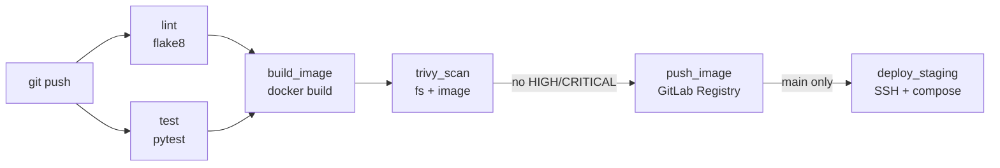

# Flask + GitLab CI/CD with Security Scanning

> A small Flask service shipped through a complete GitLab pipeline: **lint → test → build → Trivy scan → push → deploy to staging**.


The application is intentionally tiny — the point of the project is the **pipeline**: every commit is linted and tested, the image is scanned for HIGH/CRITICAL vulnerabilities before it is allowed into the registry, and `main` is automatically rolled out to a staging VM over SSH.

---

## Contents

- [Pipeline](#pipeline)
- [Application](#application)
- [Tech Stack](#tech-stack)
- [Project Structure](#project-structure)
- [Run Locally](#run-locally)
- [CI/CD Variables](#cicd-variables)
- [Staging VM Requirements](#staging-vm-requirements)
- [How Deployment Works](#how-deployment-works)
- [Security Notes](#security-notes)

---

## Pipeline



| Stage | Job | What it does |
|-------|-----|--------------|
| lint | `lint` | `flake8` over the app and tests |
| test | `test` | `pytest` unit tests |
| build | `build_image` | Builds the image tagged `$CI_COMMIT_SHA` and `staging`, saves it as an artifact (`image.tar`) |
| scan | `trivy_scan` | `trivy fs` (dependencies + misconfig) and `trivy image` — **fails the pipeline** on HIGH/CRITICAL |
| push | `push_image` | Pushes both tags to the GitLab Container Registry |
| deploy | `deploy_staging` | Rolls out to the staging VM (only on `main`, serialized via `resource_group`) |

The image is built **once** and passed between jobs as an artifact, so exactly the image that was scanned is the one that gets pushed.

## Application

| Method | Path | Response |
|--------|------|----------|
| `GET` | `/` | `{"service": "demo-web", "version": "<APP_VERSION>"}` |
| `GET` | `/health` | `ok` |

`APP_VERSION` is injected at build time (`--build-arg APP_VERSION=$CI_COMMIT_SHORT_SHA`) and defaults to `dev`.

## Tech Stack

| Area | Tools |
|------|-------|
| App | Python 3.12, Flask |
| Quality | flake8, pytest |
| Containers | Docker, Docker Compose |
| CI/CD | GitLab CI/CD, GitLab Container Registry, Docker-in-Docker |
| Security | Trivy (SCA + image scanning) |

## Project Structure

```text
.
├── app.py                    # Flask application
├── requirements.txt
├── Dockerfile
├── .gitlab-ci.yml            # CI/CD pipeline
├── deploy/
│   └── docker-compose.yml    # compose file used on the staging VM
└── tests/
    └── test_app.py
```

## Run Locally

**Python**

```bash
python3 -m venv .venv && source .venv/bin/activate
pip install -r requirements.txt
python app.py               # http://localhost:8080
```

**Docker**

```bash
docker build -t demo-web:local --build-arg APP_VERSION=local .
docker run --rm -p 8080:8080 demo-web:local
```

**Quality checks**

```bash
flake8 app.py tests
python -m pytest -q
```

## CI/CD Variables

Set in **Settings → CI/CD → Variables** (mark secrets as *Masked* and *Protected*):

| Variable | Example | Purpose |
|----------|---------|---------|
| `STAGING_HOST` | `203.0.113.10` | Staging VM address |
| `STAGING_SSH_PORT` | `22` | SSH port |
| `STAGING_USER` | `ubuntu` | SSH user |
| `STAGING_PATH` | `/opt/demo-web` | Project directory on the VM |
| `STAGING_URL` | `http://203.0.113.10:8080` | Environment URL shown in GitLab |
| `SSH_PRIVATE_KEY` | — | Private key for the VM |
| `REGISTRY_USER` | — | Deploy Token username (read_registry) |
| `REGISTRY_PASSWORD` | — | Deploy Token password |

## Staging VM Requirements

- Docker and the Docker Compose plugin installed
- `STAGING_USER` can run Docker (member of the `docker` group)
- Port `8080` reachable

## How Deployment Works

On every push to `main`, `deploy_staging`:

1. Connects to the VM over SSH (host key pinned via `ssh-keyscan`)
2. Copies `deploy/docker-compose.yml` to `$STAGING_PATH`
3. Writes `.env` with `IMAGE=$CI_REGISTRY_IMAGE:staging`
4. On the VM runs `docker login` → `docker compose pull` → `docker compose up -d --remove-orphans` → `docker image prune -f`

## Security Notes

- **Shift-left scanning:** vulnerable dependencies or base images block the release before they reach the registry.
- **Least privilege:** the VM pulls with a read-only *Deploy Token*, not personal credentials.
- **No secrets in the repo:** all credentials live in masked CI/CD variables.

Possible next steps: pin the Trivy version instead of `curl | sh`, sign images with Cosign, run the container as a non-root user, and add a Trivy report artifact for the GitLab Security dashboard.

---

## Related Projects

- [gitlab-ci-ec2-deploy](https://github.com/spaceman5789/gitlab-ci-ec2-deploy) — the same idea, deployed to AWS EC2 via Docker Hub
- [fullstack-cicd-monitoring-aws](https://github.com/spaceman5789/fullstack-cicd-monitoring-aws) — Terraform + GitLab CI/CD + monitoring on AWS

## Author

**Denis Nazarov** — DevOps Engineer · [GitHub](https://github.com/spaceman5789) · [Portfolio](https://denzo-portfolio.site)
